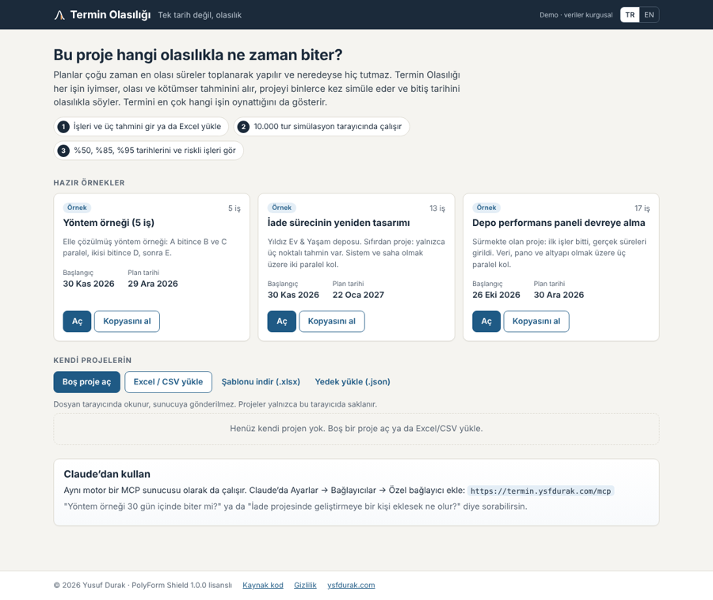
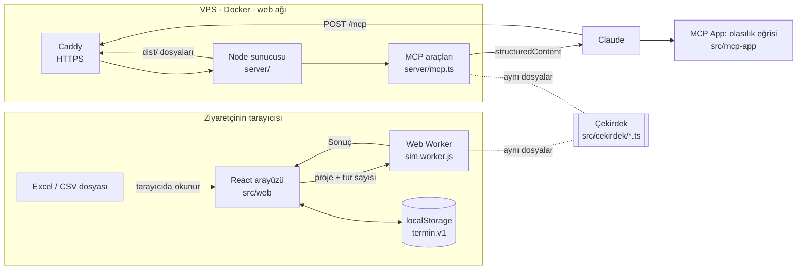
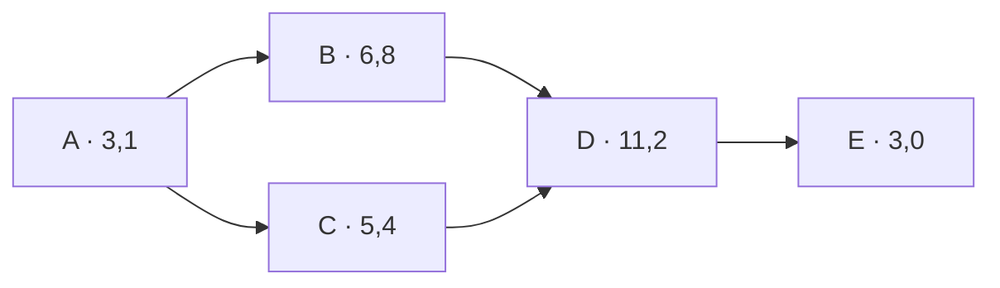
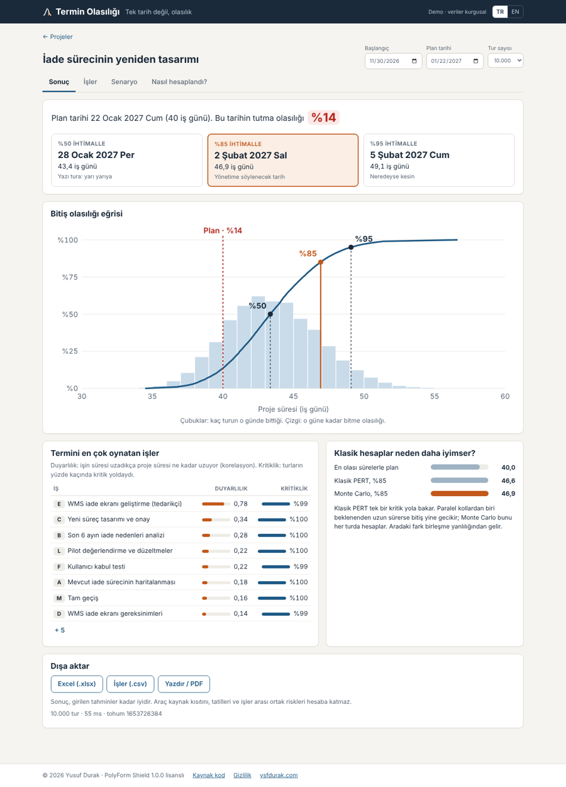
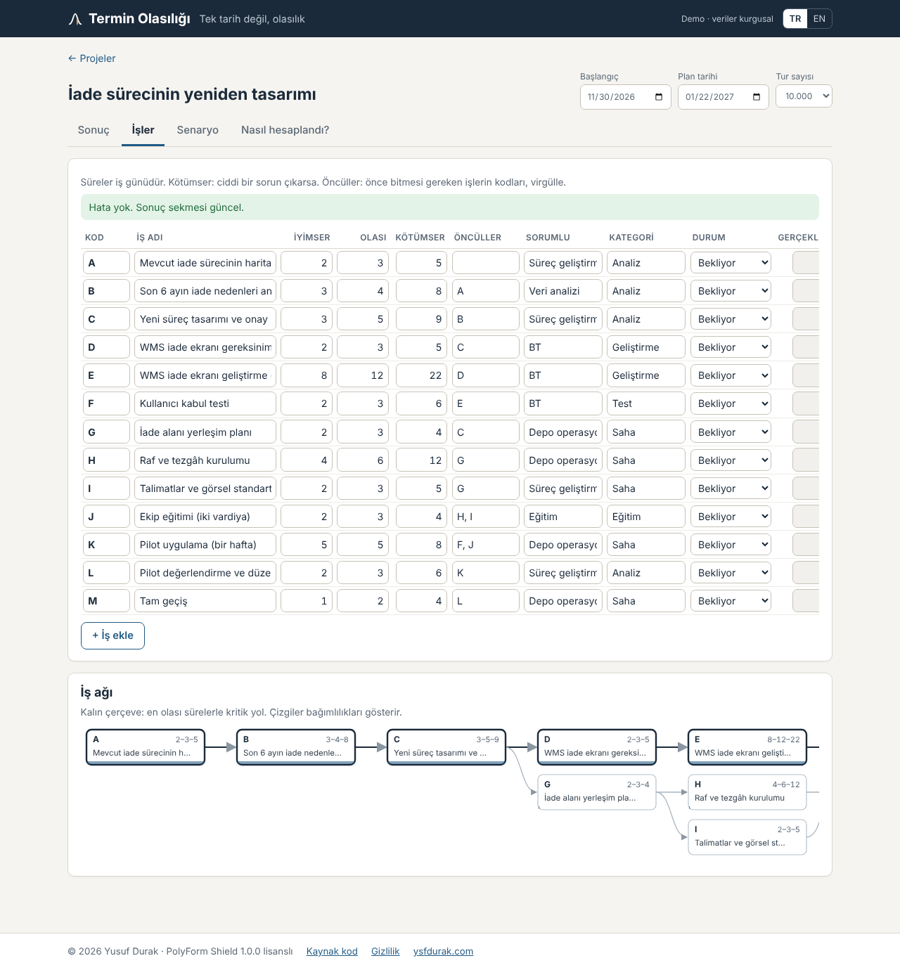
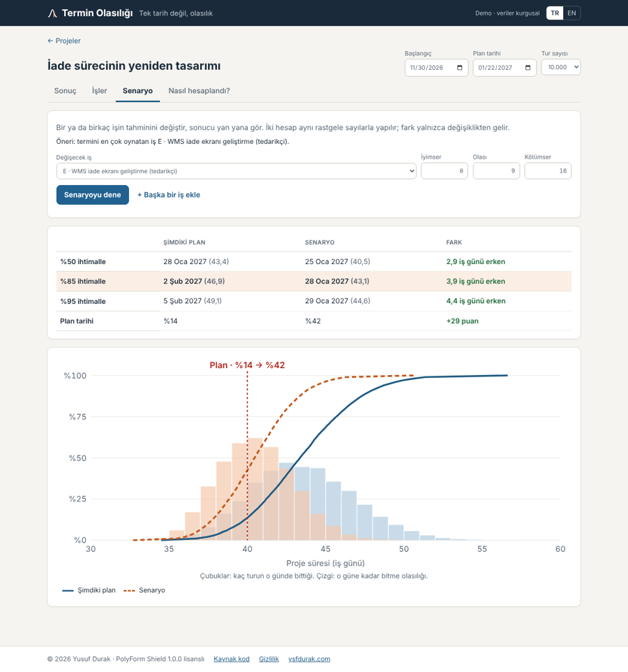
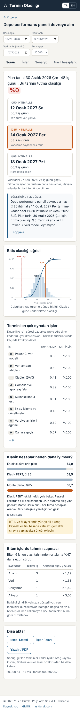

# Termin Olasılığı: proje dokümanı (hâkimiyet rehberi)

> Yaşayan doküman: kod değiştikçe aynı commit'te güncellenir. Ortak altyapı (GitHub, Cloudflare, VPS,
> Docker, Caddy, güvenlik temeli, lisans) burada tekrar anlatılmaz: `ysfdurak.com` deposunda
> `docs/NASIL-CALISIR.md` ve `docs/GUVENLIK_TEMELI.md`.

---

## 1. Bir bakışta

| | |
| --- | --- |
| **Ne** | Projenin bitiş tarihini tek bir tarih yerine olasılıkla veren araç: %50 / %85 / %95 tarihleri, plan tarihinin tutma olasılığı, termini en çok oynatan işler, senaryo |
| **Kimin için** | Proje yöneticisi ve ekip lideri (tahmin girer), yönetici (tarihe ne kadar güvenebileceğini okur), portföy ziyaretçisi (2 dakikada yöntemi görür) |
| **Canlı adres** | https://termin.ysfdurak.com (TR/EN) · MCP: `https://termin.ysfdurak.com/mcp` |
| **Depo** | github.com/ysfdurak/termin-olasiligi |
| **Durum** | V1 (27 Kasım 2026): çekirdek, web, MCP + MCP App. Yayın bekliyor (depo, Cloudflare kaydı, VPS kurulumu) |
| **Kapsam dokümanı** | Claude Docs: "Termin Olasılığı — Kapsam Dokümanı" (16 Kasım 2026) |



---

## 2. Sorun ve kararların

**Sorun.** Planlar en olası süreler toplanarak yapılır. Bu iki hata yapar:

1. Belirsizliği yok sayar: "3 gün" aslında "2 ile 6 gün arası, büyük ihtimalle 3".
2. **Birleşme yanlılığı:** iki paralel kol bir işte birleşiyorsa, o iş *uzun süren kolu* bekler.
   Ortalamaların maksimumu, maksimumun ortalamasından küçüktür. Kâğıt üstündeki plan bu yüzden
   sistematik olarak iyimserdir.

**Senin verdiğin kararlar** (mülakatın asıl konusu):

| Karar | Gerekçe |
| --- | --- |
| Talep Kuyruğu ve Portföy Masası yerine Termin Olasılığı | Diğerleri şirkette olmayan efor/kazanç verisi istiyordu. Bu araç yalnız süre tahmini ve bağımlılık ister |
| Kalibrasyon ve Domino ayrı proje değil, V2/V3 modülü | Aynı çekirdeği kullanırlar; ayrı projeler zayıf kalırdı |
| Pusula'ya bağlı değil, Excel/CSV ile çalışır | Pusula kullanmayan şirket için de gerçekçi olsun |
| V1'de kaynak kısıtı, tatil, maliyet yok | Kapsam: tek soruya cevap. "Aynı sorumlu, çakışan işler" uyarısıyla dürüstçe söyleniyor |
| İş günü birimi, hafta sonu atlanır | Proje planları iş günüyle konuşulur; tatil takvimi V1 dışı |

**Claude'un varsayılan olarak seçtikleri** (kapsamdaki açık sorular; değiştirmek istersen söyle):
ad *Termin Olasılığı / Deadline Odds*, iş günü, Pusula bağlantısı Excel dışa aktarmasıyla, ziyaretçi
dosyası tarayıcıda (kayıt yok), TR/EN arayüz.

---

## 3. Mimari ve veri akışı



**Tek çekirdek, iki kapı.** Hesap kodu (`src/cekirdek/`) bir kez yazıldı. Tarayıcıda Vite onu paketler,
sunucuda Node onu **derlemeden** çalıştırır (Node 22.18+ TypeScript tiplerini silip çalıştırır).
Aynı proje + aynı tohum = web'de ve Claude'da aynı sayı.

**Sunucu neden veri saklamıyor?** Ziyaretçinin dosyası ve projeleri tarayıcıda kalır; bu KVKK açısından
en temiz yoldur ve sunucuya veritabanı, yedek, oturum gerekmez. MCP de durumsuzdur: araçlar proje
nesnesini girdi olarak alır, güncel nesneyi çıktı olarak döner. Kayıtlı projeler (giriş gerektirir) V2.

**Peki neden VPS?** Web kısmı statik olsa Cloudflare'de dururdu. MCP kapısı sürekli açık bir sunucu
istediği için VPS'te, diğer projelerle aynı Caddy arkasında çalışıyor.

---

## 4. Yöntem: içeride gerçekte ne oluyor

### 4.1 Üç noktalı tahmin → PERT dağılımı

Her iş için iyimser (a), olası (m), kötümser (b). Bunlardan **Beta-PERT** dağılımı kurulur:

```
α = 1 + 4(m − a)/(b − a)      β = 1 + 4(b − m)/(b − a)
süre = a + Beta(α, β) × (b − a)
ortalama μ = (a + 4m + b) / 6      yaklaşık sapma σ = (b − a) / 6
```

Beta sayısı iki Gamma sayısından üretilir: `X/(X+Y)`, X ~ Gamma(α), Y ~ Gamma(β). Gamma için
Marsaglia–Tsang yöntemi (α ≥ 1 her zaman sağlanır), o da normal dağılım ister (Box–Muller).
Kodda: `src/cekirdek/rastgele.ts`.

### 4.2 Bir tur



D, B ile C'den **uzun olanı** bekler: 3,1 + max(6,8; 5,4) + 11,2 + 3,0 = 24,1 gün. Bu turda kritik yol
A→B→D→E. Kodda bu "ileri geçiş"tir (`ag.ts → gecis`): her iş için en erken başlangıç = öncüllerin en
geç bitişi. Ardından "geri geçiş" her işin en geç bitişini bulur; bolluğu sıfır olan iş kritiktir.

### 4.3 Binlerce tur

10.000 tur → 10.000 proje süresi. Sıralanır; %85'inci değer %85 tarihidir. Plan tarihinin tutma
olasılığı = o güne kadar biten turların oranı (ikili arama: `simulasyon.ts → olasilik`).



### 4.4 Kritiklik ve duyarlılık (karıştırılan iki kavram)

| | Soru | Hesap |
| --- | --- | --- |
| **Kritiklik** | Bu iş turların yüzde kaçında kritik yoldaydı? | kritik turlar / tüm turlar |
| **Duyarlılık** | Bu işin belirsizliği termine ne kadar yansıyor? | iş süresi ile proje süresi arasındaki Pearson korelasyonu |

Yöntem örneğinde A, D, E'nin kritikliği %100. Ama duyarlılıkta D (0,71) A'nın (0,36) iki katı, çünkü
D'nin aralığı (8–16) çok daha geniş. **"Nereye odaklanalım?" sorusunun cevabı duyarlılıktır.**
Korelasyon tek geçişte toplanan Σx, Σx², Σxy ile hesaplanır, turları saklamaya gerek kalmaz.

### 4.5 Neden aynı sayı her seferinde? (tohumlu rastgele sayı)

`rastgele.ts → uretec` Mulberry32 üretecidir. Tohum proje kimliğinden gelir (`metindenTohum`).
Bunun iki faydası var:

1. Sayfayı yenileyen yönetici farklı tarih görmez ("dün 26'ydı bugün 26,1" güveni bozar).
2. **Senaryo karşılaştırması gürültüsüz olur** (ortak rastgele sayılar): önce ve sonra hesapları aynı
   sayı dizisini kullanır, fark yalnız değişiklikten gelir. Farklı tohumla 0,1 günlük bir iyileşme
   simülasyon gürültüsünde kaybolurdu.

### 4.6 Doğruluk nasıl kanıtlandı

Kapsam dokümanındaki sayılar bağımsız bir 200.000 turluk Python simülasyonundan geldi. Motor
TypeScript'te ayrı yazıldı ve aynı sonuçları vermek zorunda (`tests/cekirdek.test.ts`, ±0,2 gün):

| Ölçü | Kapsam (Python) | Motor (TS, 200.000 tur) |
| --- | --- | --- |
| %50 / %85 / %95 | 23,8 / 26,0 / 27,3 | 23,79 / 25,99 / 27,34 |
| Plan (22 gün) tutar mı | %18 | %17,6 |
| Kritiklik B / C | %36 / %64 | %35,7 / %64,3 |
| Duyarlılık D / E / A | 0,71 / 0,43 / 0,36 | 0,71 / 0,43 / 0,36 |
| Senaryo D=6/8/12 → %85 | 23,4 | 23,42 |
| %30 iyimser ekip → %85 | 33,8 | testte ±0,25 içinde |

İki bağımsız uygulama aynı sayıyı veriyorsa ikisinde aynı hatanın olma ihtimali düşüktür.

---

## 5. Teknoloji seçimleri

| Seçim | Neden | Elenen alternatif |
| --- | --- | --- |
| TypeScript çekirdek, bağımlılıksız | Web ve MCP aynı kodu çalıştırır; tipler veri modelini belgeler | Python çekirdek: tarayıcıda çalışmazdı (Pyodide ağır ve dış CDN ister) |
| Node'un tip ayıklaması (derleme adımı yok) | Sunucuda `tsc` çıktısı ya da paketleyici gerekmez; yalnız "silinebilir" sözdizimi (`erasableSyntaxOnly`) | ts-node/tsx: ek bağımlılık |
| React + Vite | Pusula ile aynı; tablo düzenleme ve sekmeler için uygun | Düz JS: tablo düzenlemesi hızla karışırdı |
| Web Worker | 10.000 tur 17 işte ~30 ms ama 500 işte 50.000 tur saniyeler sürebilir; sayfa donmasın | Ana iş parçacığı (Worker yoksa yedek yol olarak duruyor) |
| fflate + kendi .xlsx okuyucu/yazıcısı | SheetJS'in npm sürümü eski ve açıklı; güncel sürümü dış CDN'den. fflate küçük ve akışla açar (zip bombası sınırı) | SheetJS, ExcelJS (büyük) |
| SVG grafikleri elle | Bağımlılık yok, CSP sıkı kalır, yazdırmada net | Chart.js/Recharts: büyük paket |
| Resmî MCP SDK 2 + ext-apps | Pusula ile aynı yapı; MCP App ile grafik Claude içinde | Elle JSON-RPC |
| Mulberry32 | Hızlı, tohumlanabilir, simülasyon için yeterli | `Math.random`: tohumlanamaz |

---

## 6. Kod turu

```
src/cekirdek/
  tipler.ts      Is, Proje, Sonuc, Bulgu tipleri
  rastgele.ts    üreteç, normal, gamma, PERT çekilişi
  ag.ts          doğrulama (19 bulgu türü), topolojik sıra, ileri/geri geçiş, kritik yol
  simulasyon.ts  Monte Carlo döngüsü, yüzdelik, eğri, histogram, klasik PERT, en olası plan
  senaryo.ts     aynı tohumla önce/sonra
  sapma.ts       biten işlerde gerçekleşen/olası (yalnız gösterim; kalibrasyon V2)
  takvim.ts      iş günü ↔ tarih
  ice-aktar.ts   CSV okuyucu, başlık eşleme (TR/EN/Pusula), CSV yazıcı (formül enjeksiyonu önlemi)
  ornekler.ts    üç örnek proje (tarihler bugüne göre; panel örneğinde veri tarihi = bugün)
  metin.ts       bulgu metinleri TR/EN (web ve MCP aynı cümle)
src/web/
  App.jsx        yönlendirme (#/p/<id>/<sekme>), kayıt, dil
  useSim.js      Worker'a iş gönderme, 250 ms bekleyip yeniden hesap
  ekranlar/      Projeler, ProjeEkrani, Sonuc, Isler, Senaryo, Nasil
  bilesenler/    Egri.jsx (eğri + histogram), Ag.jsx (iş ağı)
  xlsx.js        .xlsx okuma/yazma
  depo.js        localStorage ve yedek dosyası (güven sınırı)
  olcum.js       ortak ölçüm (yalnız termin.ysfdurak.com'da)
src/mcp-app/     egri.html/js: Claude içindeki grafik (tek dosya)
server/
  index.ts       sunucuyu başlatır, ayarlar ortam değişkeninden
  uygulama.ts    dosya sunma, /mcp, /healthz, hata yönetimi
  guvenlik.ts    başlıklar, CSP, IP, hız ve gövde sınırı
  mcp.ts         6 araç + MCP App kaynağı
```

**Okunması gereken üç akış:**

1. **Simülasyon döngüsü** (`simulasyon.ts → simuleEt`): proje önce `dogrula`'dan geçer; `agKur` nesneleri
   dizilere çevirir (hız için: döngüde nesne oluşturulmaz); her turda süre çekilir, `gecis` çağrılır,
   kritiklik ve korelasyon toplamları güncellenir; ilk tur "Nasıl hesaplandı?" için saklanır.
2. **Biten iş** (`ag.ts → ucNokta`): `durum = bitti` ve gerçekleşen süre varsa üç nokta da o süredir;
   simülasyonda sabit kalır. Panel örneğinde plan tarihinin %0 çıkmasının sebebi budur: biten 6 iş
   tahminden %47 uzun sürmüş, plan artık tutamaz.
3. **İçe aktarma** (`ice-aktar.ts → satirlardanProje`): başlıklar sadeleştirilir ("İyimser (gün)" →
   `iyimser_gun`) ve eş adlarla eşlenir. Kod sütunu yoksa satır numarası kod olur. Pusula dosyasında
   biten işin süresi Başlangıç–Tamamlanma arasındaki iş günüdür.



**"Bu yapı uygun değil, şöyle uygulanır" örnekleri (yazarken düzeltilenler):**

- İlk hâlinde örnek projenin plan tarihi **biten işlerin gerçek süreleriyle** hesaplanıyordu; plan hep
  tutuyormuş gibi görünüyordu. Plan, proje başında bilinmeyen gerçek süreleri içeremez: plan artık
  özgün tahminlerle kuruluyor (`ornekler.ts → planla`).
- Senaryo ekranı açılınca değerler mevcut tahminlerle dolu geliyordu; "dene"ye basan "değişmedi"
  görüyordu. Düğme artık bir tahmin değişmeden açılmıyor ve ne yapılacağını söylüyor.
- Excel dosyası uzantıdan tanınıyordu; uzantısız indirilen dosya CSV sanılıp bozuk okundu. Tür artık
  içerikten ("PK" zip imzası) anlaşılıyor.
- Telefonda grafik masaüstü genişliğinde çizildiği için yazılar okunmuyordu; dar ekranda çizim alanı
  daralıyor.

---

## 7. Sunucu ve yayın

Ortak kısım (Caddy, `web` ağı, Cloudflare kaynak kısıtı) el kitabında. Bu projeye özgü:

| Dosya | Ne yapar |
| --- | --- |
| `Dockerfile` | İki aşama: derleme (Vite) + çalışma (`npm ci --omit=dev`, `USER node`, HEALTHCHECK) |
| `deploy/docker-compose.ortak.yml` | `name: termin`, `read_only`, `cap_drop: ALL`, 384 MB, port açmadan `web` ağı, **birim yok** |
| `ysfdurak.com/sunucu/kurulum-termin.sh` | Kodu çeker, `.env` oluşturur, derler, Caddy'yi yeniden başlatır |
| `ysfdurak.com/sunucu/altyapi/Caddyfile` | `termin.ysfdurak.com { import uygulama termin:8080 }` |

**Yedek yok**, çünkü sunucuda veri yok. MCP açık ve anahtarsız: tüm araçlar salt okunur ve hiçbir şey
saklanmıyor; kötüye kullanıma karşı IP başına dakikada 60 istek ve en çok 20.000 tur.

**[doğrulanacak]** Docker imajı bu ortamda derlenemedi (Docker yok). CI'daki `docker` işi derleyip
sağlık ve CSP başlığını denetliyor; ilk gönderimde yeşil olduğunu gör.

---

## 8. Testler

| Katman | Dosya | Ne denetler |
| --- | --- | --- |
| Excel biçimi | `tests/xlsx-bicim.test.ts` (1 test) | Tam sayı `#,##0`, ondalık `#,##0.0`, yüzde; değer saf sayı |
| Çekirdek | `tests/cekirdek.test.ts` (16 test) | Kapsam sayıları, tek tur elle hesap, tohum, senaryo, 19 bulgu türü, takvim, CSV/Pusula içe aktarma, formül enjeksiyonu, performans |
| Sunucu + MCP | `tests/sunucu.test.ts` (7 test) | CSP ve 6 başlık, satır içi betik yok, dizin gezme (4 deneme), 405/413/415/400/403/429, 6 aracın tamamı, MCP App kaynağı |
| Tarayıcı | `tests/e2e/gezinti.py` (16 kontrol) | Konsol/CSP hatası yok, sayılar ekranda, senaryo, hata iletisi, CSV ve .xlsx şablon gidiş-dönüş, kötü yedek reddi, kayıttaki betik çalışmıyor, İngilizce, telefonda taşma yok |
| Güvenlik | `tara.py --audit` + `zehir_gezgin.py` (iki kip) | Temiz; 74 kayıtlı metin betikle değiştirildi, tetiklenen yok |

**Örneklem test sonucu (27 Kasım 2026, yerel):**

| Adım | Beklenen | Gözlenen | Durum |
| --- | --- | --- | --- |
| Yöntem örneği açılır | %18, 26,0 iş günü | %18, 26,0 | ✓ |
| Olası > kötümser yazılır | Kırmızı hata, sekmede (1!) | Öyle | ✓ |
| Senaryo E=8/9/16 (iade) | %85 öne gelir | 3,9 gün erken, plan %14 → %42 | ✓ |
| Canlıda başlıklar | CSP var | **[yayından sonra]** | — |

**Windows örneklem testi (28 Kasım 2026, Excel):**

| Adım | Beklenen | Gözlenen | Durum |
| --- | --- | --- | --- |
| Şablonu indir, Excel'de satır ekle (F Kullanıcı eğitimi 1,5 / 2 / 4), geri yükle | Yeni iş tanınır | Tanındı | ✓ |
| "Excel (.xlsx)" sonucunu aç | Onar uyarısı yok | Yok | ✓ |
| Tur sayısı hücresi | 10.000 | 10000,0 (her sayı `0.0` biçimindeydi) → 0.1.1'de düzeltildi, Excel'de yeniden açıldı: 10.000; iş günleri 40,0 / 43,4 | ✓ |

> **Ders:** Excel'de görünüm (biçim) ile değer ayrıdır. Hücreye `10000` yazıp biçimi `0.0` verirsen Excel
> `10000,0` gösterir; değer yine 10000'dir. Düzeltme yazıcıda: tam sayı → `#,##0` (yerleşik biçim 3),
> ondalık → `#,##0.0`. Virgül "binlik ayraç" demektir; Türkçe Excel onu noktaya çevirir.
> İş günü sütununda ise 40 ile 43,4 yan yana durunca tutarsız görünür; bu yüzden süre hücreleri
> `{ v: 40, ondalik: true }` olarak yazılır ve hep `40,0` görünür. Tur sayısı gibi sayaçlar tam sayı kalır.



**Burada bir test daha yapalım:**
- Pusula'dan gerçek bir dışa aktarma + üç tahmin sütunu: başlıklar tanınıyor mu?
- Gerçek Android telefonda sonuç sayfası ve grafik (dar ekran çizimi).
- Claude'da bağlayıcıyı ekleyip "yöntem örneği 30 gün içinde biter mi?": eğri Claude içinde açılmalı.



---

## 9. Bilinen sınırlar ve sonraki adımlar

- İşler bağımsız varsayılır (ortak risk yok). İleride korelasyon katsayısı seçeneği.
- Kaynak kısıtı yok; aynı sorumluya çakışan işler yalnız uyarı.
- Tatil yok. "Devam eden" iş toplam süresiyle hesaplanır; veri tarihi onun bugünden önce bitmesini
  engeller ama "kalan gün" alanı yok (Pusula bağlantısında eklenmeli).
- **V1.1:** Pusula MCP'sinden doğrudan proje çekme. **V2:** kalibrasyon (kategori başına ≥10 biten iş),
  girişli kayıt. **V3:** Domino (gecikmenin ağda yayılımı).

**Şöyle daha iyi olur (öneriler, karar senin):**
- İade örneğinde saha kolu (G, H, I, J) neredeyse hiç kritik değil; geliştirme işi (E) her şeyi
  belirliyor. Gerçekçi ama tek boyutlu: istersen saha koluna da tedarikçi riski eklenir (raf teslimi
  4/6/18 gibi), böylece iki kol yarışır ve birleşme yanlılığı daha görünür olur.
- "Devam" durumundaki işe "kalan gün" alanı eklemek, sürmekte olan projelerde tahmini çok iyileştirir.

---

## 9b. Kullanıcı gözüyle inceleme (27 Kasım 2026)

**Teşhis:** Ekranlar teknik olarak doğruydu; asıl açık, sürmekte olan projede "bugün"ün hesapta
olmamasıydı. Bunu teknik testler değil, proje yöneticisi gözü buldu.

| Rol | Görev | Bulgu | Karar |
| --- | --- | --- | --- |
| Alan uzmanı (proje yöneticisi) | Sürmekte olan projede tarih al | Gecikmiş projede başlamamış işler geçmişte başlıyormuş gibi hesaplanıyordu; tarih iyimser kalıyordu | **Veri tarihi** eklendi: bitmemiş iş bu tarihten önce başlayamaz, devam eden bu tarihten önce bitemez (`ag.ts → basAlt/bitAlt`, test eklendi) |
| Yönetici | Sonucu bir cümleyle iletmek | Sayılar vardı, iletilecek cümle yoktu | Manşete "Yöneticiye tek cümle" ve Kopyala |
| Günlük kullanıcı | Senaryo dene | Değer değiştirmeden "dene" → "değişmedi" | Düğme değişiklik olmadan kapalı, ne yapılacağı yazıyor |
| Günlük kullanıcı | Excel yükle | Uzantısız dosya yanlış okunuyordu | Tür içerikten anlaşılıyor; eski .xls için açık ileti |
| Tasarımcı | Telefonda sonuç | Grafik yazıları okunmuyordu, tablo çubukları satırı kırıyordu | Dar ekranda çizim alanı daralıyor, çubuklar gizleniyor |
| Tasarımcı | İşler tablosu | Durum seçimi "Bel…" diye kesiliyordu | Sütun genişlikleri düzeltildi |
| İlk kez gelen | 10 saniyede ne bu? | Başlık soru, 3 adım, hazır örnekler: anlaşılıyor | Değişiklik yok |
| Mülakatçı | 5 dakikada değer | Yöntem örneği %18 ile başlıyor, "Nasıl hesaplandı?" kara kutuyu açıyor | Değişiklik yok |
| Erişilebilirlik | Klavye, etiketler | Tablo girişlerinde etiket var; olasılık rozeti renk + sayı | Değişiklik yok |

**Ders:** "Hata yok, testler yeşil" bir şey; "bu tarih gerçekte tutar mı?" başka bir şey. Sürmekte
olan projede bugünü bilmeyen bir tahmin aracı, gecikmeyi geçmişe gömer.

**Sıradaki:** devam eden iş için "kalan gün"; iade örneğinde saha koluna tedarikçi riski (öneri).

---

## 10. Mülakat soruları ve cevapları

**1. "%85 tarihini nasıl hesaplıyorsun?"**
Her iş için üç tahminden PERT dağılımı kuruyorum. Her turda her işe bu dağılımdan bir süre çekip ağı
hesaplıyorum: bir iş, öncüllerinin en geç biteni bitince başlar. 10.000 turun proje süresini sıralayıp
%85'inci değeri alıyorum ve iş günü takvimiyle tarihe çeviriyorum.

**2. "Klasik PERT ile Monte Carlo neden farklı?"**
Klasik PERT ortalamalarla tek bir kritik yol seçer ve diğer kolları yok sayar. Paralel kollardan biri
bir turda uzun sürerse bitiş gecikir; Monte Carlo bunu her turda görür. Bu birleşme yanlılığıdır.
Örnekte PERT %85'i 25,4, Monte Carlo 26,0.

**3. "Kritiklik ile duyarlılık farkı?"**
Kritiklik "kaç turda kritik yoldaydı", duyarlılık "süresi uzadıkça proje ne kadar uzuyor". Belirsizliği
küçük bir iş her turda kritik olup termini az oynatabilir. Odaklanılacak yer duyarlılığı yüksek iştir.

**4. "Tahminler zaten yanlışsa bu araç neye yarar?"**
İki şey: belirsizliği görünür kılar ("22 gün" yerine "%18 ihtimalle 22 gün") ve biten işlerde
gerçekleşen/olası oranını gösterir. V2'de bu oranla yeni tahminler kalibre edilecek. Sonuç girilen
tahminler kadar iyidir; bunu ekranda açıkça söylüyorum.

**5. "Kaç tur yeterli?"**
Yüzdelik değerlerin turlar arttıkça sabitlenmesine bakılır. Örnekte 10.000 turla %85 25,99, 200.000
turla 25,99. Arayüzde 1.000 / 10.000 / 50.000 seçilebiliyor; MCP'de üst sınır 20.000 (sunucu maliyeti).

**6. "Kaynak kısıtını neden V1'e almadın?"**
Kapsam kararı: V1 tek soruya cevap veriyor. Kaynak düzleme ayrı bir optimizasyon problemi. Yerine,
aynı sorumluya aynı anda yürüyebilen iş verilmişse uyarı gösteriyorum; kullanıcı öncül ekleyerek
sıralayabiliyor.

**7. "Aynı projeyi iki kez hesaplayınca neden aynı sonuç çıkıyor, bu rastgelelik değil mi?"**
Tohumlu üreteç kullanıyorum. Hem yöneticinin gördüğü sayı sabit kalıyor hem de senaryo karşılaştırmasında
iki hesap aynı rastgele sayıları kullandığı için fark yalnız değişiklikten geliyor (ortak rastgele sayılar).

**8. "Web ve Claude neden aynı sonucu veriyor?"**
Tek çekirdek: tarayıcıda Vite paketliyor, sunucuda Node TypeScript'i derlemeden çalıştırıyor. Aynı
dosya, aynı tohum.

**9. "Kullanıcının dosyası nerede saklanıyor?"**
Hiçbir yerde, tarayıcıda okunuyor. Projeler o tarayıcının localStorage'ında. Sunucu veri saklamıyor;
MCP de durumsuz. KVKK açısından en temiz yol, ayrıca yedek ve veritabanı derdi yok.

**10. "Excel dosyasından saldırı gelebilir mi?"**
Zip bombası: açılmış boyut açılırken sayılıyor, 40 MB'ta duruyor. Değerler tür/uzunluk denetiminden
geçiyor. Ekrana yazarken React kaçışlıyor; betikli yedek dosyası reddediliyor. Dışarı verdiğim CSV'de
`=`, `+`, `-`, `@` ile başlayan metnin başına `'` ekliyorum (formül enjeksiyonu).

---

## 11. Kendini test et (cevaplar altta)

1. A=2/3/6 işinin PERT ortalaması kaç?
2. Bir turda B=4, C=7 çekildi; D ne zaman başlar (A=3)?
3. Plan tarihi 22. iş günü; 10.000 turun 1.786'sı 22 gün ya da daha kısa. Tutma olasılığı?
4. Duyarlılığı 0,05, kritikliği %100 olan bir iş için ne söylersin?
5. Senaryo karşılaştırmasında neden aynı tohum kullanılıyor?
6. Pusula dosyasında "Tamamlandı" durumundaki işin gerçek süresi nereden gelir?

<details><summary>Cevaplar</summary>

1. (2 + 12 + 6) / 6 = 3,33
2. 3 + max(4; 7) = 10. gün sonunda
3. %17,9 (≈ %18)
4. Her turda kritik ama belirsizliği küçük (ör. sabit süreli ya da dar aralıklı); termini az oynatır, odak başka yerde
5. Fark simülasyon gürültüsünden değil, değişiklikten gelsin diye (ortak rastgele sayılar)
6. Başlangıç ve Tamamlanma tarihleri arasındaki iş günü sayısından

</details>

---

## 12. Elle yapılacak alıştırma ve 5 dakikalık demo

**Alıştırma (15 dakika):** Hızlı seçim olarak 100.000 turu ekle.
1. `src/web/ekranlar/ProjeEkrani.jsx` dosyasında `const TURLAR = [1000, 10000, 50000];` satırını bul.
2. `100000` ekle. `npm run dev` ile aç, seç ve "Sonuç"un altındaki süreye (ms) bak.
3. Soru: neden 100.000 turda sonuç 10.000 tura göre çok az değişiyor? (Cevap: 5. mülakat sorusu.)

**İkinci alıştırma:** `src/cekirdek/ornekler.ts`'de iade örneğinde H (raf kurulumu) kötümserini 12'den
18'e çıkar; `npm test` çalıştır (hangi test kırılıyor, neden kırılmıyor?), sonra arayüzde saha kolunun
kritikliğine bak.

**5 dakikalık demo akışı:**
1. (30 sn) Sorun: "Planlar neden tutmaz?" Yöntem örneğini aç: plan 22 gün, tutma olasılığı **%18**.
2. (1 dk) Eğri: %50 / %85 / %95. "Yönetime %85 tarihini söylüyorum."
3. (1 dk) Klasik kıyas kartı: en olası 22, PERT 25,4, Monte Carlo 26,0 → birleşme yanlılığı.
4. (1 dk) Riskli işler: D'nin duyarlılığı en yüksek. Senaryo: D'yi 6/8/12 yap → %85 2,6 gün öne.
5. (1 dk) Panel örneği: biten işler %47 uzun sürmüş, plan artık tutmuyor; sapma tablosu, V2 kalibrasyonu.
6. (30 sn) Claude'da: "İade projesi 1 Şubat'a yetişir mi?" → eğri Claude'un içinde açılıyor.

---

## 13. Değişiklik günlüğü

| Tarih | Sürüm | Değişiklik |
| --- | --- | --- |
| 2026-11-16 | — | Kapsam dokümanı (Claude Docs) |
| 2026-11-28 | 0.1.1 | Excel çıktısında sayı biçimi: tam sayılar binlik ayraçlı (Tur sayısı 10.000), ondalıklar `#,##0.0`; Windows Excel testi |
| 2026-11-27 | 0.1.0 | Kullanıcı gözüyle inceleme: veri tarihi, yöneticiye tek cümle, senaryo düğmesi, Excel türü içerikten, telefon düzeni |
| 2026-11-27 | 0.1.0 | V1: çekirdek (kapsam sayılarıyla doğrulandı), TR/EN web arayüzü, Excel/CSV/Pusula içe aktarma, 6 MCP aracı + MCP App, güvenlik temeli, ortak ölçüm, Docker ve kurulum betiği |
